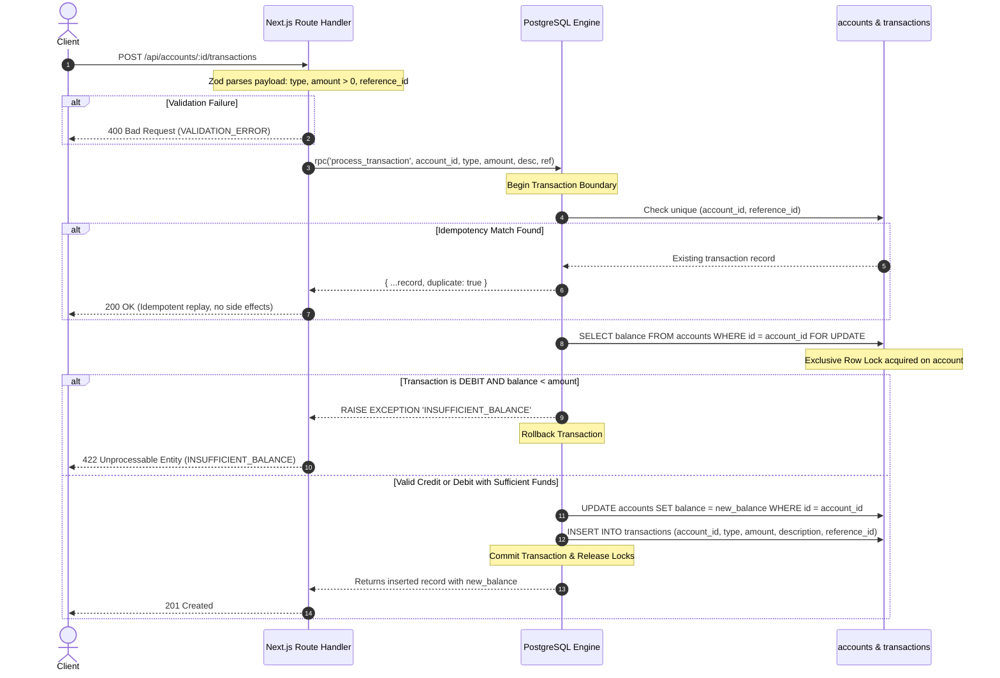
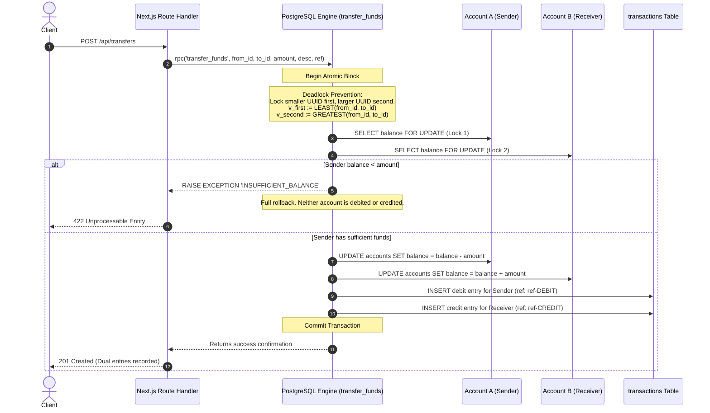

# Ledgerly — Financial Transaction Ledger Engine

A production-grade, double-entry transaction ledger built with Next.js 14 (App Router), TypeScript, and PostgreSQL (Supabase).

Financial software has one sacred rule: **never lose track of the money, never create money from thin air, and never let two concurrent requests spend the same dollar twice.** Ledgerly enforces strict ACID guarantees at the database engine level, treating application servers as stateless orchestrators and PostgreSQL as the single source of truth.

---

## Architecture Overview

```
                                      +---------------------------------------------+
                                      |                 Client                      |
                                      |    (Browser Dashboard or REST API Client)   |
                                      +----------------------+----------------------+
                                                             |
                                                             | HTTP POST/GET (JSON)
                                                             v
+---------------------------------------------------------------------------------------------------+
| Next.js 14 App Router (Route Handlers)                                                            |
|                                                                                                   |
|   1. Runtime Payload Validation via Zod Schemas                                                   |
|      - Parses UUIDs, positive numeric amounts, non-empty strings, sanitizes inputs                |
|                                                                                                   |
|   2. Idempotency Key Handling & Query Parsing                                                     |
|      - Offset-based pagination with clamp controls (limit <= 100, default 10)                     |
|                                                                                                   |
|   3. Stored Procedure Invocation                                                                  |
|      - Direct RPC dispatch to PostgreSQL via Supabase Service Client                              |
+--------------------------------------------+------------------------------------------------------+
                                             |
                                             | RPC call (process_transaction / transfer_funds)
                                             v
+---------------------------------------------------------------------------------------------------+
| PostgreSQL Database Engine (ACID Transaction Boundary)                                            |
|                                                                                                   |
|   1. Idempotency Check (SELECT id FROM transactions WHERE account_id = ... AND reference_id = ...) |
|      -> Hit? Returns existing transaction with duplicate: true (HTTP 200 Replay). Zero mutation. |
|                                                                                                   |
|   2. Row-Level Locking (SELECT balance FROM accounts WHERE id = ... FOR UPDATE)                   |
|      -> Serializes concurrent writes on the same account; prevents race condition double-spends.  |
|                                                                                                   |
|   3. Balance Verification & Invariant Enforcement                                                 |
|      -> Debit: Validates (balance >= amount). Rejects with INSUFFICIENT_BALANCE if violated.      |
|      -> Credit: Adds amount directly.                                                             |
|      -> DB Check Constraint: CHECK (balance >= 0) acts as an unbreakable safety net.              |
|                                                                                                   |
|   4. Atomic Ledger Mutation                                                                       |
|      -> UPDATE accounts SET balance = new_balance                                                 |
|      -> INSERT INTO transactions (id, account_id, type, amount, description, reference_id)        |
|      -> COMMIT transaction                                                                        |
+---------------------------------------------------------------------------------------------------+
```

---

## Complete Execution Flow Diagrams

### 1. Atomic Transaction Flow (Credit / Debit)

The following diagram illustrates how single-account transactions are evaluated, locked, and committed atomically:



---

### 2. Double-Entry Transfer Flow (Deadlock-Free Concurrency)

When transferring funds between Account A and Account B, locking them in arbitrary order creates textbook distributed system deadlocks (e.g. Request 1 locks A and waits for B, while Request 2 locks B and waits for A). Ledgerly solves this by sorting UUIDs before acquiring row locks:



---

## Technical Implementation Details

### 1. Eliminating Race Conditions via PostgreSQL Row Locking
In high-throughput environments, checking an account balance in application memory before sending an update creates a critical race condition. Two parallel withdrawal requests of \$100 against a \$100 balance will both read \$100, pass validation, and leave the account at -\$100.

Ledgerly pushes balance calculation into a PL/pgSQL stored procedure using:
```sql
SELECT balance INTO v_current_balance
FROM accounts
WHERE id = p_account_id
FOR UPDATE;
```
This acquires an exclusive lock on that account's row until the transaction commits or aborts. Any concurrent transaction attempting to read or write that account pauses until the lock clears, guaranteeing strictly serialized execution.

### 2. Deterministic Deadlock Avoidance
When two concurrent requests attempt cross-transfers between the same two accounts:
- Request 1: Transfer from Account A to Account B
- Request 2: Transfer from Account B to Account A

If Request 1 locks A and waits for B, while Request 2 locks B and waits for A, PostgreSQL detects a deadlock and kills one of the transactions.

Ledgerly eliminates deadlocks deterministically:
```sql
-- Always lock accounts in lexicographical UUID order, regardless of transfer direction
v_first_lock_id  := LEAST(p_from_account_id, p_to_account_id);
v_second_lock_id := GREATEST(p_from_account_id, p_to_account_id);

PERFORM 1 FROM accounts WHERE id = v_first_lock_id FOR UPDATE;
PERFORM 1 FROM accounts WHERE id = v_second_lock_id FOR UPDATE;
```
Because both requests acquire locks in the exact same sequence, deadlocks are mathematically impossible.

### 3. Financial Precision: Exact Numerics vs IEEE 754
Floating point numbers (`FLOAT`, `DOUBLE`, JavaScript `Number`) use binary fractions that cannot represent decimal currency values accurately (e.g. `0.1 + 0.2 = 0.30000000000000004`). In a financial ledger, rounding drift leads to systemic reconciliation discrepancies.

- **PostgreSQL Column Type:** `NUMERIC(15, 2)` — exact fixed-point arithmetic with up to 13 digits of integer currency and 2 decimal places.
- **Check Constraint:** `CHECK (balance >= 0)` guarantees at the storage engine level that an account can never carry a negative balance, regardless of any upstream application bug.
- **Frontend / API:** Rounded to two decimal places and formatted using `Intl.NumberFormat('en-IN', { style: 'currency', currency: 'INR' })`.

### 4. Database-Enforced Idempotency
Network calls fail. Clients retry. A payment gateway that retries a timeout should never bill a customer twice.
- Ledgerly enforces idempotency at the database layer via a compound unique constraint:
  ```sql
  CONSTRAINT uq_account_reference UNIQUE (account_id, reference_id)
  ```
- When a request arrives with an existing `(account_id, reference_id)` pair, the procedure returns the original transaction record with `duplicate: true` and an HTTP 200 status code. The database state remains untouched.

---

## Step-by-Step Setup Guide

### What You Need To Do

#### Step 1: Clone and Install Dependencies
```bash
git clone https://github.com/machinelearningprodigy/Ledgerly.git
cd Ledgerly/ledger-app
pnpm install
```

#### Step 2: Configure Environment Variables
Copy the example environment template:
```bash
cp .env.example .env.local
```

Supply your Supabase project credentials in `.env.local`:
```env
NEXT_PUBLIC_SUPABASE_URL=https://your-project-id.supabase.co
NEXT_PUBLIC_SUPABASE_ANON_KEY=your-supabase-anon-key
SUPABASE_SERVICE_ROLE_KEY=your-supabase-service-role-key
```

#### Step 3: Run the Schema Migration
1. Log in to your [Supabase Dashboard](https://supabase.com).
2. Navigate to the **SQL Editor** on the left navigation panel.
3. Open `supabase/migrations/001_initial_schema.sql` from this repository.
4. Paste the entire SQL script into the editor and click **Run**.

#### Step 4: Launch the Production Build or Dev Server
- **Development Server:**
  ```bash
  pnpm dev
  ```
  Accessible at `http://localhost:3000`.

- **Production Build:**
  ```bash
  pnpm build
  pnpm start
  ```

---

### What Will Happen

1. **Database Initialization:**
   The migration creates two tables: `accounts` and `transactions`, establishes check constraints (`balance >= 0`, `amount > 0`), enables Row-Level Security (RLS), and registers the stored procedures `process_transaction` and `transfer_funds`.
2. **Account Creation:**
   When you create an account via `POST /api/accounts`, it is initialized with a balance of exactly `₹0.00`. The client cannot manipulate the starting balance.
3. **Transaction Processing:**
   When you submit a credit or debit via `POST /api/accounts/:id/transactions`, the database opens an ACID transaction, locks the specific account row, recalculates the balance, records the immutable transaction log, and commits.
4. **Overdraft Protection:**
   If you attempt to debit `₹500.00` from an account holding `₹100.00`, the stored procedure aborts immediately with an `INSUFFICIENT_BALANCE` exception. The API returns an HTTP 422 status code with the exact balance discrepancy.
5. **Idempotency Replay:**
   If the exact same payload is submitted with an identical `reference_id`, the system detects the unique constraint, bypasses balance calculation, and returns the original transaction record with `"duplicate": true` and HTTP 200.

---

## API Reference & Contracts

### Base Path
All API endpoints are hosted at `/api`.

| Method | Endpoint | Description | Expected Status Codes |
|---|---|---|---|
| `POST` | `/api/accounts` | Create new account (starts at ₹0.00 balance) | `201 Created`, `400 Bad Request` |
| `GET` | `/api/accounts` | List paginated accounts (`page`, `limit`) | `200 OK`, `400 Bad Request` |
| `GET` | `/api/accounts/:id` | Fetch account details and current balance | `200 OK`, `404 Not Found` |
| `POST` | `/api/accounts/:id/transactions` | Atomic credit or debit on target account | `201 Created`, `200 OK (Dupe)`, `400`, `404`, `422` |
| `GET` | `/api/accounts/:id/transactions` | Paginated transaction history with type filtering | `200 OK`, `400 Bad Request`, `404 Not Found` |
| `POST` | `/api/transfers` | Atomic double-entry transfer between two accounts | `201 Created`, `200 OK (Dupe)`, `400`, `404`, `422` |

---

### Request & Response Examples

#### 1. Create Account
`POST /api/accounts`
```json
// Request
{
  "name": "Rohan Gupta"
}

// Response (201 Created)
{
  "data": {
    "id": "bbba5705-f16f-4b0c-92ad-3cba12cb09ba",
    "name": "Rohan Gupta",
    "balance": 0.00,
    "created_at": "2026-10-26T14:38:50.000Z"
  }
}
```

#### 2. Process Credit Transaction
`POST /api/accounts/bbba5705-f16f-4b0c-92ad-3cba12cb09ba/transactions`
```json
// Request
{
  "type": "credit",
  "amount": 8200.00,
  "description": "Monthly Engineering Retainer",
  "reference_id": "PAY-2026-10-RG"
}

// Response (201 Created)
{
  "data": {
    "id": "670c52bb-b3b4-4b95-88ec-a3098f98ec85",
    "account_id": "bbba5705-f16f-4b0c-92ad-3cba12cb09ba",
    "type": "credit",
    "amount": 8200.00,
    "description": "Monthly Engineering Retainer",
    "reference_id": "PAY-2026-10-RG",
    "created_at": "2026-10-26T14:39:10.000Z",
    "new_balance": 8200.00
  }
}
```

#### 3. Idempotent Duplicate Replay
Submitting the exact same transaction request again returns the cached record without side effects:
```json
// Response (200 OK)
{
  "data": {
    "id": "670c52bb-b3b4-4b95-88ec-a3098f98ec85",
    "account_id": "bbba5705-f16f-4b0c-92ad-3cba12cb09ba",
    "type": "credit",
    "amount": 8200.00,
    "description": "Monthly Engineering Retainer",
    "reference_id": "PAY-2026-10-RG",
    "created_at": "2026-10-26T14:39:10.000Z"
  },
  "message": "Transaction already exists",
  "duplicate": true
}
```

#### 4. Insufficient Balance Error
`POST /api/accounts/:id/transactions` (Debit exceeding balance)
```json
// Response (422 Unprocessable Entity)
{
  "error": {
    "code": "INSUFFICIENT_BALANCE",
    "message": "Account balance (150.00) is less than debit amount (500.00)",
    "details": {}
  }
}
```

#### 5. List Paginated Transactions
`GET /api/accounts/:id/transactions?page=1&limit=10&type=debit`
```json
// Response (200 OK)
{
  "data": [
    {
      "id": "7fa120bd-d754-4638-b7eb-d1e57c63b782",
      "account_id": "bbba5705-f16f-4b0c-92ad-3cba12cb09ba",
      "type": "debit",
      "amount": 799.00,
      "description": "Apple Developer Subscription",
      "reference_id": "SM-DB-RG-APPL",
      "created_at": "2026-10-26T14:39:20.000Z"
    }
  ],
  "pagination": {
    "page": 1,
    "current_page": 1,
    "limit": 10,
    "page_size": 10,
    "total_records": 14,
    "total_pages": 2
  }
}
```

---

## Error Handling Standards

All errors conform to a predictable structure:
```json
{
  "error": {
    "code": "STRING_IDENTIFIER",
    "message": "Human-readable explanation of what went wrong",
    "details": {}
  }
}
```

| Error Code | HTTP Status | Trigger Condition |
|---|---|---|
| `VALIDATION_ERROR` | `400` | Malformed JSON, negative amount, missing reference ID, invalid UUID format |
| `ACCOUNT_NOT_FOUND` | `404` | Requested account ID does not exist |
| `INSUFFICIENT_BALANCE` | `422` | Attempted debit exceeds current available balance |
| `INVALID_TRANSFER` | `400` | Attempting to transfer funds from an account to itself |
| `INTERNAL_ERROR` | `500` | Unexpected database disconnect or unhandled internal exception |

---

## User Interface & Design System

The application features a dark obsidian and crimson red aesthetic:
- **Dark / Light Mode**: Dynamic switching powered by `next-themes` with zero hydration mismatch and localStorage persistence.
- **Responsive Navigation Sidebar**: Left-hand navigation rail on desktop with mobile drawer support, featuring quick action triggers for Transfers, New Account creation, and a live API Reference sheet.
- **Profile Avatars**: Public portrait images mapped deterministically to account IDs, paired with a graceful SVG fallback to user initials.
- **Audit-Trail Ledger**: Filter transactions by `All`, `Credit`, or `Debit` with live pagination controls and color-coded status badges.
- **Glassmorphism Selectors**: Custom search dropdowns with balance indicators and source/destination validation to prevent self-transfers.

---

## Repository Structure

```
Ledgerly/
├── PRD.md                         # Product Requirements Document
├── ASSUMPTIONS.md                 # Design assumptions & trade-off rationale
├── README.md                      # Engineering documentation (this file)
└── ledger-app/
    ├── src/
    │   ├── app/
    │   │   ├── api/
    │   │   │   ├── accounts/      # /api/accounts Route Handlers
    │   │   │   └── transfers/     # /api/transfers Route Handlers
    │   │   ├── accounts/[id]/     # Account detail view & transaction ledger
    │   │   ├── layout.tsx         # Root layout with ThemeProvider & Toaster
    │   │   ├── page.tsx           # Accounts dashboard & balance metrics
    │   │   └── globals.css        # Tailwind CSS and theme tokens
    │   ├── components/
    │   │   ├── accounts/          # Account creation & selection components
    │   │   ├── layout/            # Sidebar navigation & API reference dialog
    │   │   ├── transactions/      # Add transaction & fund transfer modals
    │   │   ├── ui/                # Base UI elements (buttons, dialogs, cards)
    │   │   ├── ThemeToggle.tsx    # Dark/Light mode toggle switch
    │   │   └── UserAvatar.tsx     # Public avatar mapper with fallback initials
    │   ├── lib/
    │   │   ├── errors.ts          # Centralized API error response handler
    │   │   ├── utils.ts           # Currency formatters & zod parsers
    │   │   ├── validations/       # Zod schemas for accounts & transactions
    │   │   └── supabase/          # Supabase client & server instances
    │   └── types/                 # TypeScript interfaces for models & pagination
    └── supabase/
        └── migrations/
            └── 001_initial_schema.sql  # Schema, RLS, indexes & stored procedures
```

---

## License

MIT License. Designed and implemented for the Cofluencer Full-Stack Technical Assessment.
